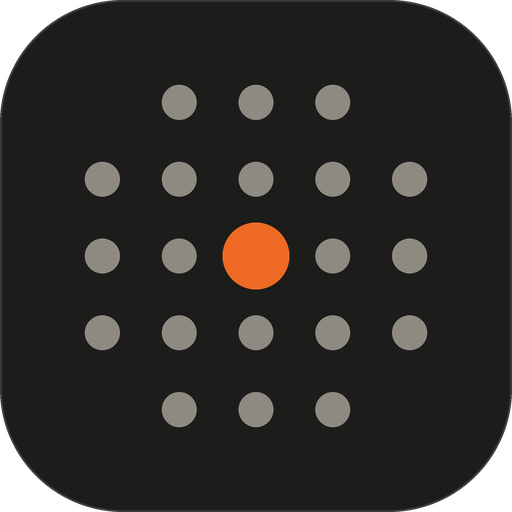
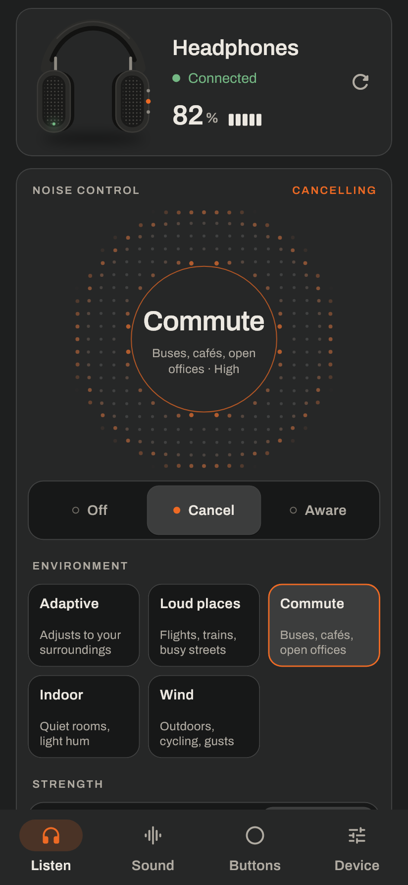
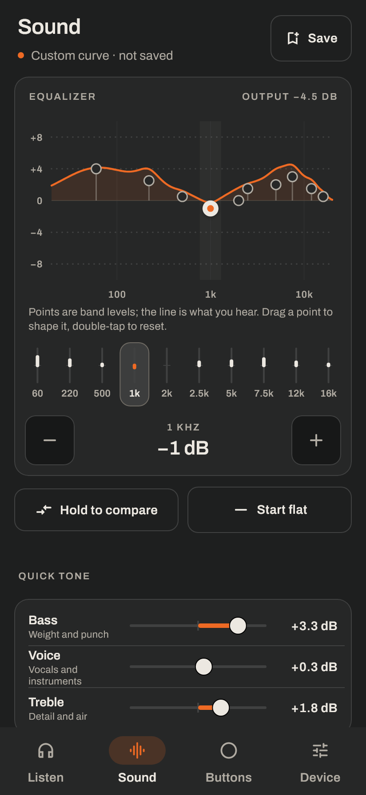
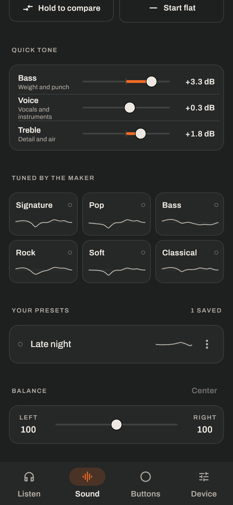
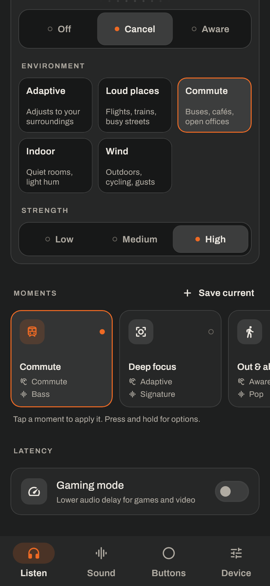
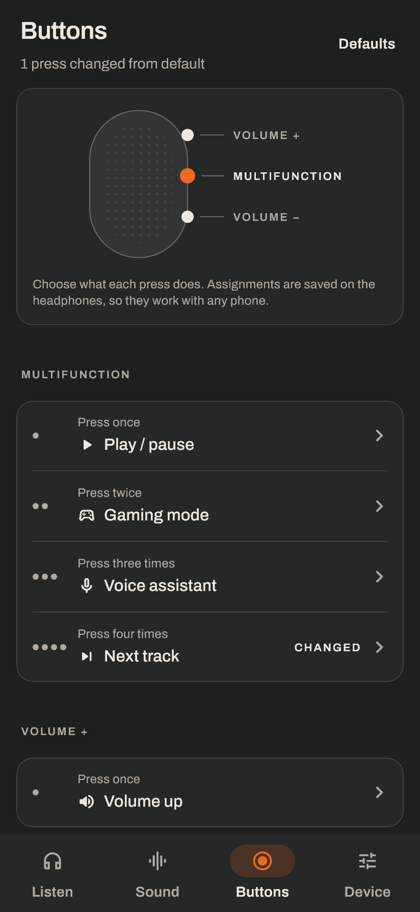
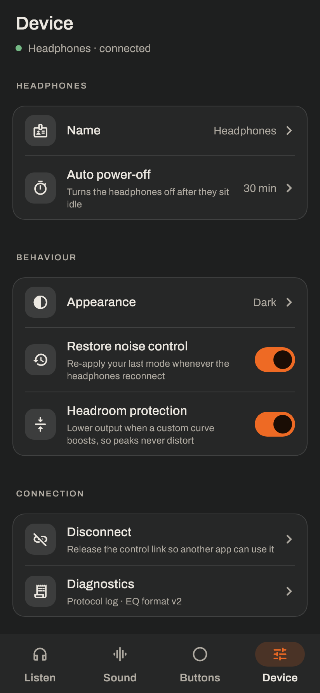
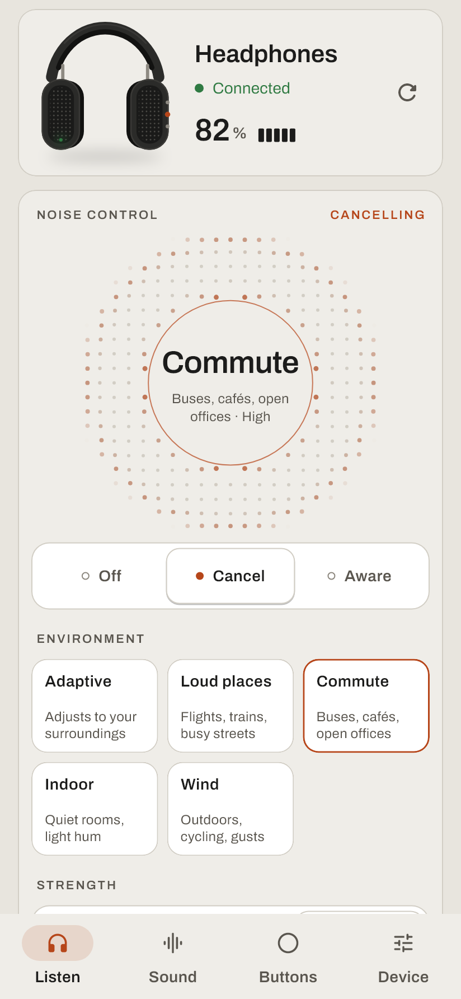
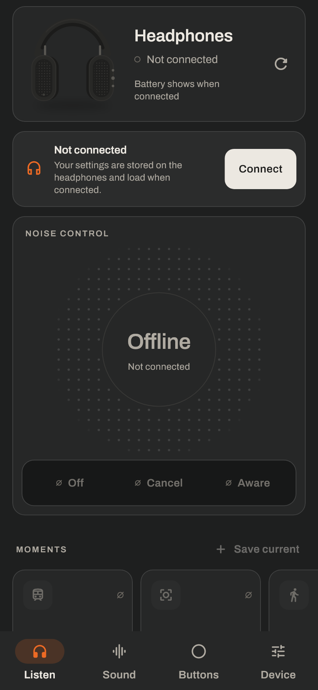
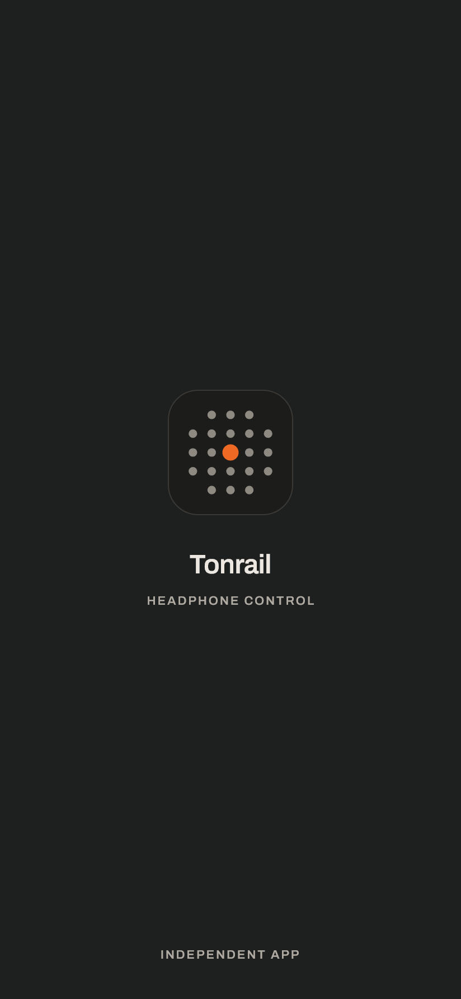

<div align="center">



# Tonrail

**A calm, precise, open-source Android controller for your Bluetooth headphones.**
Noise control, a 10-band equalizer, button remapping and device settings, without the clutter.

[](https://github.com/iamnaveenoff/tonrail/actions/workflows/ci.yml)
[](LICENSE)


</div>

---

## Screenshots

| Listen | Sound | Presets |
|:---:|:---:|:---:|
|  |  |  |
| **Moments** | **Buttons** | **Device** |
|  |  |  |
| **Light theme** | **Offline** | **Splash** |
|  |  |  |

<sub>Screenshots are rendered from the real widget tree with demo data (`flutter test test/screenshots_test.dart --dart-define=SCREENSHOTS=true`).</sub>

## Features

**Listen**
- Live headphone status: connection, battery level and charging.
- Noise control with one slide: **Off · Cancel · Aware**.
- Five cancelling environments (Adaptive, Loud places, Commute, Indoor, Wind) with Low / Medium / High strength where supported.
- **Moments**: one-tap combinations of noise mode, sound preset and gaming mode. Save your own.
- Gaming mode (low latency).

**Sound**
- 10-band equalizer (60 Hz to 16 kHz, ±8 dB in 0.5 dB steps). Drag points on the curve, pick a band and nudge it with ± buttons, or double-tap a point to reset it.
- **Quick tone**: Bass, Voice and Treble sliders that move groups of bands together.
- Six built-in tunings with curve previews, plus your own saved presets (rename and delete).
- **Hold to compare** against a flat response, and **Start flat** with Undo.
- **Headroom protection**: lowers output automatically when a curve boosts, so it never distorts.
- Left/right balance that snaps to centre.

**Buttons and device**
- Remap the multifunction button (1–4 presses), Volume + and Volume − to any of 8 actions. Changed presses are marked.
- Rename the headphones, set auto power-off, restore noise mode on reconnect.
- Dark (default), light or system appearance.
- Diagnostics log of every command, copyable for bug reports.
- Restore factory settings and forget paired phones, with confirmation.

## Compatibility

| | |
|---|---|
| **Headphones** | Spigen SA-HP P10. Tested on a real unit. Other models are not supported. |
| **Phone** | Android 7.0 (API 24) or newer, with Bluetooth Low Energy. Tested on Android 16. |
| **iOS** | Not supported yet. |

> [!NOTE]
> Tonrail is an **independent, community project**. It is not made, endorsed, sponsored or supported by Spigen or any headphone maker. Product names are trademarks of their owners and are used here only to describe compatibility.

**How it connects.** Supported headphones show up twice in Bluetooth: an audio link that you pair in Android settings, and a Bluetooth LE control link. Tonrail talks only to the control link, and prefers the headphones paired with your phone when several are nearby.

**Good to know**
- Pair the headphones in Android Bluetooth settings first, as you normally would for audio.
- Only one app can hold the control link at a time. Close the headphones' official app before using Tonrail.
- Noise mode, buttons and EQ are stored **on the headphones**. Presets and Moments are stored **on your phone**.
- Firmware updates are not offered.

Trouble connecting? Open a [device report](https://github.com/iamnaveenoff/tonrail/issues/new?template=device_report.yml) and attach the Diagnostics log.

## Install

Download the latest APK from [Releases](https://github.com/iamnaveenoff/tonrail/releases) and open it on your phone. Android will ask you to allow installs from your browser or file manager.

On first launch Tonrail asks for **Nearby devices** permission. It is only used to talk to the headphones.

## Build from source

Requirements: [Flutter](https://docs.flutter.dev/get-started/install) 3.44 or newer (Dart 3.12), Android SDK, JDK 17.

```bash
git clone https://github.com/iamnaveenoff/tonrail.git
cd tonrail
flutter pub get
flutter run                       # debug build on a connected phone
flutter build apk --release       # release APK in build/app/outputs/flutter-apk/
```

Release signing is described in [docs/RELEASING.md](docs/RELEASING.md). Without a key, release builds are signed with the debug key so `flutter run --release` still works.

### Tests

```bash
flutter analyze
flutter test                      # protocol, controller and UI tests
```

The UI tests open every screen in dark and light themes, at normal and 130% text size, connected and offline, and fail on any layout overflow. They also drive the real controls against a simulated headset.

## Project structure

```text
lib/
├── main.dart                   App entry, splash → tab shell
├── protocol/
│   ├── framing.dart            Packet framing and decoder for the BLE control link
│   └── commands.dart           Commands: noise, EQ, buttons, settings, parsing
├── device/
│   └── headset_controller.dart Bluetooth link, sync, optimistic updates, presets, Moments
├── data/
│   └── store.dart              Local storage (shared_preferences)
└── ui/
    ├── theme.dart              Colours, type and component themes
    ├── appearance.dart         Light / dark / system preference
    ├── scope.dart              Gives widgets access to the controller
    ├── screens/                Splash, Listen, Sound, Buttons, Device
    └── widgets/                Panel kit, noise grille, EQ editor, headphone art
test/                           Protocol, UI and screenshot tests
docs/                           Protocol notes, release guide, screenshots
```

More detail: [docs/PROTOCOL.md](docs/PROTOCOL.md) (the Bluetooth commands) and [DESIGN.md](DESIGN.md) (the visual system).

## Privacy

- Nothing is uploaded: no analytics, ads, accounts or tracking.
- Stored on your phone only: presets, Moments, the last connected device ID and your settings.

The Bluetooth library ([flutter_blue_plus](https://pub.dev/packages/flutter_blue_plus)) may send a small license ping **at build time** (package name, app name and version). This happens on the developer's machine during `flutter build`, never on users' phones.

## Contributing

Contributions are welcome: bug reports, device reports, translations and code. Read [CONTRIBUTING.md](CONTRIBUTING.md) and the [Code of Conduct](CODE_OF_CONDUCT.md) first. Security issues go through [SECURITY.md](SECURITY.md).

## License

Tonrail is released under the [MIT License](LICENSE).

Third-party parts keep their own licenses:
- [flutter_blue_plus](https://pub.dev/packages/flutter_blue_plus/license) uses the **FlutterBluePlus License**. It is free for personal use, nonprofits and education; **for-profit use requires a commercial license** from its author. If you fork Tonrail for a commercial product, get that license or replace the library.
- The [Archivo](https://fonts.google.com/specimen/Archivo) typeface is under the SIL Open Font License 1.1 ([assets/fonts/OFL.txt](assets/fonts/OFL.txt)).
- Material icons are under the Apache License 2.0.

## Disclaimer

Tonrail was built independently, for interoperability, by studying how the headphones communicate over Bluetooth. It ships no code, firmware or artwork from any headphone maker. It is provided as is, without warranty; use it at your own risk.
